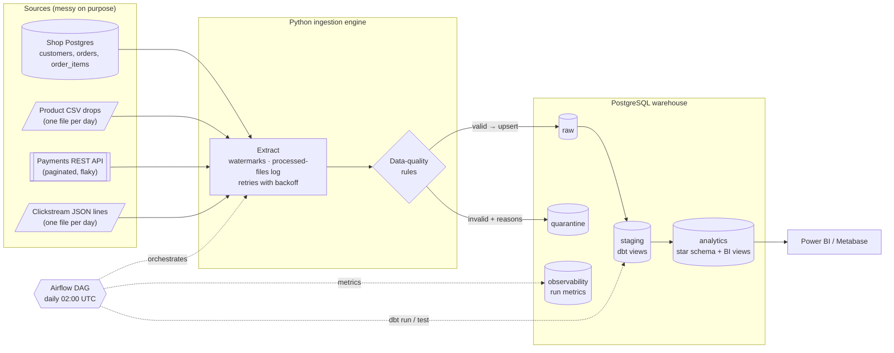
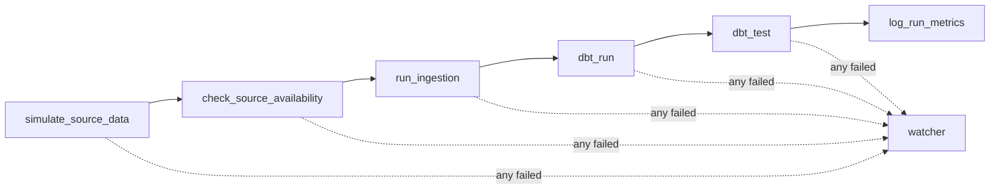
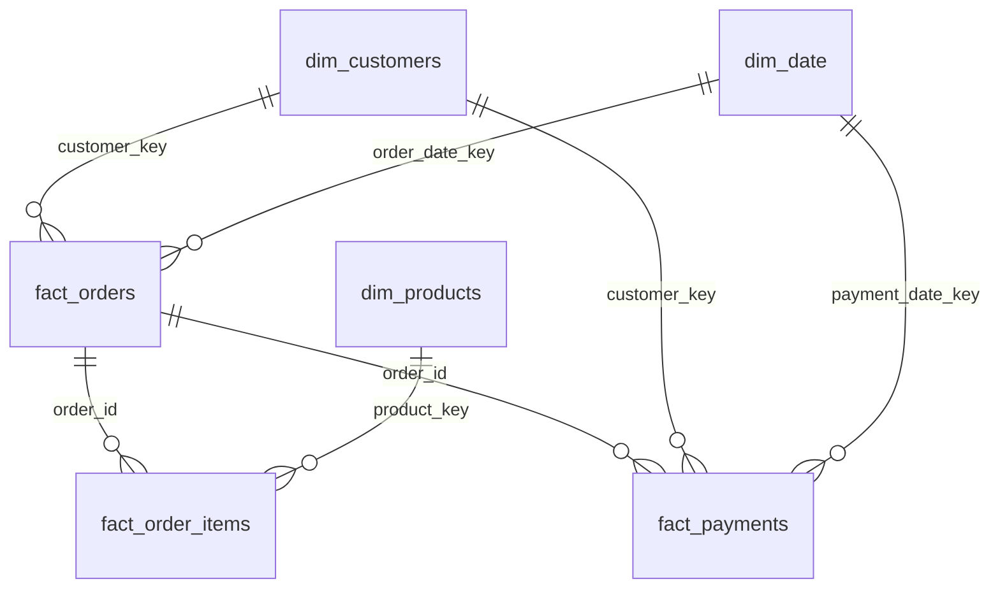

# DataFlow — Production-Ready E-commerce Data Pipeline

[](https://github.com/OWNER/dataflow/actions/workflows/ci.yml)

An end-to-end batch data pipeline for an online shop. It pulls **messy data from four different
kinds of sources**, keeps bad records in a **quarantine** instead of losing them, loads the good ones
**incrementally and idempotently**, models them into a **star schema with dbt**, tests them, runs
everything **daily with Airflow**, and records **metrics for every run**.

| | |
|---|---|
| **Languages** | Python 3.11, SQL |
| **Storage** | PostgreSQL 15 (`raw` → `staging` → `analytics`, plus `quarantine` and `observability`) |
| **Transform / test** | dbt Core 1.11 (staging views, star schema, incremental model, SCD2 snapshot, 88 data checks) |
| **Orchestration** | Apache Airflow 2.10 (LocalExecutor), Slack / email alerts |
| **Infra** | Docker Compose, GitHub Actions CI (lint + full pipeline run on every PR) |
| **BI** | SQL views ready for Power BI / Metabase |

---

## Architecture



### The daily DAG



| Task | What it does |
|---|---|
| `simulate_source_data` | Demo only: makes the fake shop produce that day's data. Re-running is a no-op. |
| `check_source_availability` | Source DB, API, file drops and warehouse reachable? Fails fast before doing work. |
| `run_ingestion` | Incremental, idempotent load → `raw`; rejected rows → `quarantine`. |
| `dbt_run` | Source freshness check, customer snapshot (SCD2), all models. |
| `dbt_test` | Data tests. `error` tests fail the run; `warn` tests are reported only. |
| `log_run_metrics` | One row in `observability.pipeline_runs` — **runs even if something failed**. |
| `watcher` | Marks the whole run FAILED if any task failed (the metrics task alone would hide it). |

### Star schema (`analytics`)



- `dim_customers` — one row per **real person**: duplicate sign-ups (same email, different case) are merged. Contains an **Unknown (-1)** member so orders with broken customer ids still join.
- `dim_products` — product catalogue + **UNKNOWN** member.
- `dim_date` — calendar.
- `fact_orders` — one row per order: items, payments, `net_revenue`, data-quality flags.
- `fact_order_items` — one row per order line, with cost and margin.
- `fact_payments` — one row per payment attempt (**incremental** model).
- `snapshots.snap_customers` — full history of customer changes (SCD type 2).

---

## Quickstart

You need **Docker Desktop** (give it ≥ 4 GB RAM). On Windows, run commands in **WSL2**.

```bash
git clone https://github.com/OWNER/dataflow.git && cd dataflow
make up          # = cp .env.example .env && docker compose up -d --build
```

Wait ~1–2 minutes until `docker compose ps` shows everything **healthy**, then:

1. Open **http://localhost:8080** (user `admin`, password `admin`).
2. Unpause **`dataflow_pipeline`** and press ▶ *Trigger DAG* — or run `make trigger`.
   The first run creates 30 days of messy history in the sources, then runs the whole pipeline.
3. Look at the results:

```bash
make runs         # last pipeline runs and their metrics
make quarantine   # why records were rejected
make psql         # SQL shell on the warehouse (port 5433 from your laptop)
```

| Service | From your laptop |
|---|---|
| Airflow UI | http://localhost:8080 |
| Warehouse Postgres | `localhost:5433`, db `warehouse`, user/pass `dataflow` |
| Source (shop) Postgres | `localhost:5434`, db `shop`, user/pass `shop` |
| Mock payments API | http://localhost:8000/docs |
| Metabase (optional) | http://localhost:3000 — `docker compose --profile bi up -d metabase` |

No Make? Every target is a one-liner — see the [`Makefile`](Makefile). `make help` lists them all.

### Run without Docker (for development)

```bash
python3.11 -m venv .venv && source .venv/bin/activate
pip install -r requirements-dev.txt
cp .env.example .env              # point the *_HOST/_PORT values at your Postgres
set -a && source .env && set +a   # dbt reads env vars, not .env

python -m data_generators.generate init --days 30         # messy sources
(cd api/mock_payments && uvicorn main:app --port 8000 &)   # payments API
python -m ingestion.healthcheck
python -m ingestion.run
dbt build --project-dir dbt_dataflow
pytest -q
```

---

## Repository layout

```
├── airflow/dags/               dataflow_pipeline_dag.py + helpers (alerts, metrics)
├── api/mock_payments/          FastAPI payments API (pagination, random 429/500/503)
├── data_generators/            day-by-day shop simulator that injects bad data
├── dbt_dataflow/
│   ├── models/staging/         stg_* views (clean, rename, type, normalise)
│   ├── models/marts/           dims + facts (star schema)
│   ├── models/bi/              views for dashboards
│   ├── snapshots/              SCD2 customer history
│   ├── tests/                  singular + custom generic tests
│   └── macros/                 schema naming
├── docker/                     Airflow Dockerfile, Postgres init SQL
├── ingestion/
│   ├── extractors/             postgres.py, api.py, files.py
│   ├── validators/core.py      rules + messy-value parsers
│   ├── entities.py             per-entity schema + data-quality rules
│   ├── loaders/warehouse.py    COPY → temp → merge, quarantine
│   ├── state.py                watermarks, processed files
│   ├── retry.py                exponential backoff + jitter, Retry-After
│   ├── pipeline.py / run.py    per-source jobs, CLI
│   └── sql/warehouse_ddl.sql   raw, quarantine, observability tables
├── tests/                      pytest (unit + Postgres integration)
├── Makefile                    shortcuts (`make help`)
└── .github/workflows/ci.yml    lint + full pipeline + dbt build on every PR
```

---

## How it works

### 1. Messy sources (on purpose)

`data_generators/generate.py` simulates the shop **one day at a time**: new customers and orders,
orders moving `placed → paid → shipped → delivered → returned`, pending payments succeeding,
refunds, price changes, new products. It also injects **~35 kinds of bad data**, for example:

| Source | Examples of injected problems |
|---|---|
| Postgres | same person signs up twice (`ANA@X.COM` vs `ana@x.com`), missing / invalid emails, orders with no timestamp or dated 1970, negative totals, unknown statuses, orders for customers that don't exist, double-submitted orders, totals that don't match their lines, zero / negative quantities |
| CSV | missing product ids, `"N/A"` prices, negative prices, `"$1,234.50"` prices (cleanable), impossible dates, duplicate rows, the same product twice with different prices |
| API | missing order ids, negative amounts, broken dates, unknown statuses, amounts as strings, lowercase currency, duplicates, payments for unknown orders, **plus random HTTP 429 / 500 / 503** |
| JSON lines | truncated (broken) JSON lines, missing event ids, dates like `"yesterday"`, unknown event types, duplicate events |

### 2. Ingestion: incremental, idempotent, with quarantine

For every source the engine does **extract → validate → load → save state** in one transaction.

- **Incremental loading.** Database and API sources keep a **high-water mark** (latest `updated_at`
  seen) in `observability.ingestion_watermarks`. File sources keep a log of processed files with a
  **checksum**, so a re-delivered (changed) file is loaded again. Each run re-reads a short
  **lookback window** (default 60 min) to catch rows from transactions that committed late.
- **Idempotent upserts.** Rows are bulk-loaded with `COPY` into a temp table, then merged with
  `INSERT … ON CONFLICT DO UPDATE`. The update only happens if the row **really changed**
  (`_record_hash`) **and** the incoming version is **not older** (`updated_at`). Running the same
  batch twice changes nothing — so retries and backfills are always safe. CI checks this on every PR.
- **Data-quality guardrails.** Each entity has rules in `ingestion/entities.py` (required keys,
  types, ranges, allowed values, no future timestamps…). A row that fails **any** rule goes to
  `quarantine.rejected_records` **exactly as received**, with **every** rule it broke. Nothing is dropped silently.
- **Failure recovery.** Network errors, timeouts, dropped DB connections and HTTP 429/5xx are
  retried with **exponential backoff + jitter** (and `Retry-After` is respected). Bad requests and
  bugs fail fast. Each source runs on its own: if the API is down, the others still load, the API's
  watermark stays where it was, and the next run catches up automatically.

### 3. dbt: staging → star schema → tests

- **Staging views** clean and normalise (lower-case emails and statuses, flatten the clickstream JSON,
  link duplicate customer accounts).
- **Marts** build the star schema. `fact_payments` is **incremental** (`delete+insert` with a
  3-day lookback); `fact_orders` is a **full rebuild** on purpose (see the cheat sheet).
- **88 checks**: unique / not-null / relationships / accepted values, custom generic tests
  (`non_negative`, `expression_is_true`), and singular tests:
  - `assert_fact_orders_reconcile_with_staging` — **error**: fact rows and money must match staging.
  - `assert_order_totals_match_items`, `assert_no_double_submitted_orders`,
    `assert_payments_do_not_exceed_order_total`, `assert_rejection_rate_below_threshold` — **warn**.
- Known source problems (orphans, unknown products) are **`warn`**, so they're visible but don't
  block the business; they're mapped to Unknown members in the facts.
- Failing rows of every test are saved in the **`test_failures`** schema for inspection.
- **Source freshness** warns when `raw` hasn't been loaded for 26 h and errors after 50 h.

### 4. Observability

| Table / view | Grain | Use it for |
|---|---|---|
| `observability.pipeline_runs` | one row per DAG run | status, duration, records in / rejected, rejection %, dbt models & tests, failed tasks |
| `observability.ingestion_runs` | one row per source per run | extracted / valid / quarantined / inserted / updated / unchanged, watermark before → after, errors |
| `observability.ingestion_watermarks` | one row per source | where each incremental source is |
| `observability.processed_files` | one row per file | which file drops were loaded, checksum |
| `quarantine.rejection_summary` | entity × reason | what is going wrong upstream |

**Alerts.** Set `SLACK_WEBHOOK_URL` in `.env` to get a Slack message when any task fails (with the
error and a link to the log), and a warning when more than `REJECTION_ALERT_PCT` % of records are
quarantined. For email, set `ALERT_EMAIL` and the `AIRFLOW__SMTP__*` values.

---

## BI layer (Power BI / Metabase)

Six views in the `analytics` schema, built and **tested by dbt** (`dbt_dataflow/models/bi/`):

| View | Grain | Answers |
|---|---|---|
| `bi_daily_revenue` | day (zero-filled calendar) | Net revenue, gross order value, refunds, AOV, 7-day average, month-to-date |
| `bi_revenue_by_category` | month × category | Revenue, units, gross margin % by category |
| `bi_order_volume` | day | Orders by status, new vs returning customers, orders with data-quality issues |
| `bi_customer_ltv` | customer | Lifetime value, AOV, days since last order, segment (New / Active / At risk / Lapsed), LTV quartile |
| `bi_payment_failure_rate` | day × payment method (+ `ALL`) | Failed-payment rate, failed amount, most common failure reason |
| `bi_kpi_summary` | one row | Headline KPIs: last 30 days vs previous 30, avg LTV, failed-payment rate, last pipeline status |

Definitions used everywhere:

- **Net revenue** = order total of orders that are **paid** and **not cancelled / returned**.
- **Customer LTV** = sum of net revenue per real person (duplicate accounts merged).
- **Failed payment rate** = failed ÷ settled attempts (pending attempts are left out until they resolve).
- All dates are **UTC** business days.

**Power BI:** *Get data → PostgreSQL database* → server `localhost:5433`, database `warehouse`,
user/pass `dataflow` → pick the `analytics.bi_*` views (Import mode is fine at this size).
Suggested page: KPI cards from `bi_kpi_summary`, a line chart of `bi_daily_revenue`, a stacked
column chart of `bi_revenue_by_category`, a table of top `bi_customer_ltv`, and a line chart of
`bi_payment_failure_rate` filtered to `ALL`.

**Metabase (free, runs in Docker):**

```bash
docker compose --profile bi up -d metabase    # then open http://localhost:3000
```
Add a PostgreSQL database: host `warehouse-db`, port `5432`, db `warehouse`, user/pass `dataflow`.

---

## Runbook

### The payments API is down

1. `check_source_availability` retries for a few minutes, then fails → Slack alert, nothing loaded.
2. If the API drops **during** ingestion: the payments source fails after its retries, other sources
   still load, `run_ingestion` fails → Airflow retries it (2 more times, backing off). Safe, because loads are idempotent.
3. Nothing to clean up. When the API is back, the next run (or *Clear* on the failed task) reads from
   the **old** watermark and catches up.

Check where each source is:

```sql
SELECT * FROM observability.ingestion_watermarks;
SELECT entity, status, error_message, finished_at
FROM observability.ingestion_runs ORDER BY id DESC LIMIT 12;
```

### Re-run / backfill

| Situation | Do this |
|---|---|
| A run failed halfway | In Airflow: **Clear** the failed task (downstream too). |
| Re-load data from a date (e.g. a source fixed bad rows) | Trigger DAG with config `{"backfill_since": "2026-09-01"}` — or `python -m ingestion.run --sources orders --since 2026-09-01` |
| Re-load everything | Trigger with `{"full_refresh": true}` (also rebuilds incremental dbt models) |
| Only one source | `python -m ingestion.run --sources payments` |
| Rebuild one dbt model and what depends on it | `dbt build -s fact_payments+ --project-dir dbt_dataflow` |
| Rebuild an incremental model from scratch (**always do this after changing its logic** — incremental runs only touch recent rows, so old rows would keep the old logic) | `dbt run -s fact_payments+ --full-refresh --project-dir dbt_dataflow` |

Backfills never move a watermark **backwards** (`GREATEST(old, new)`), so the next normal run continues correctly.

### Lots of records in quarantine

```sql
SELECT * FROM quarantine.rejection_summary ORDER BY records DESC;

SELECT reasons, payload, source, first_seen_at
FROM quarantine.rejected_records
WHERE entity = 'payments' AND resolved_at IS NULL
ORDER BY last_seen_at DESC LIMIT 20;
```

- A **new** reason or a sudden jump → something changed upstream (format, schema). Talk to the source owner.
- The source fixes the record → its `updated_at` changes → the next incremental run loads it into `raw`.
  Then mark it done: `UPDATE quarantine.rejected_records SET resolved_at = now() WHERE id = …;`
- The rule was wrong → fix it in `ingestion/entities.py`, add a test, run a backfill for that source.

### A dbt test failed

- **error** tests stop the run (`dbt_test` fails, Slack alert). Warn tests don't.
- See the failing rows: `SELECT * FROM test_failures.<test_name>;` (the name is in the task log).
- Or locally: `dbt test -s <model> --project-dir dbt_dataflow`.

### Start completely fresh

```bash
make reset && make up && make trigger
```

---

## Interview cheat sheet

**Why incremental loading, and why not always?**
Incremental reads only what changed since the last watermark: faster, cheaper, less load on the
source. The price is complexity — you must handle late data (lookback window), deletes (not covered
here; would need soft-deletes or CDC), and backfills. Full refresh is simple and always correct but
gets slow as data grows. Here: ingestion is incremental, `fact_payments` is incremental, and
`fact_orders` is a **full rebuild** because an order's numbers change when its *items or payments*
change, so a filter on the order's own `updated_at` would miss updates. Small table → rebuild is cheap and safer.

**What does idempotent mean here, and why does it matter?**
Running a load twice gives the same result as running it once. That's what makes retries,
re-runs and backfills safe. It comes from: merge on the primary key (`ON CONFLICT`), skip
unchanged rows (`_record_hash`), never let an older version overwrite a newer one, and save the
watermark **in the same transaction** as the data.

**Why quarantine instead of dropping or failing?**
Dropping hides problems and loses data. Failing the whole pipeline for 1 bad row out of 10,000
punishes everyone. Quarantine keeps the good data flowing, keeps the bad data **with the reason**,
and gives you a metric (rejection %) to alert on. Trade-off: someone has to look at it —
hence the summary view, the Slack warning and `resolved_at`.

**Which checks live in Python and which in dbt?**
Python: **record-level** checks you can do one row at a time (types, required fields, ranges).
dbt: **set-level** checks that need other tables (orphans, duplicates across rows, totals vs lines,
reconciliation). Orphans are `warn` + mapped to an *Unknown* member, so a sales report doesn't lose revenue just because a customer row is broken.

**How do you handle API failures?**
Retry only transient errors (timeouts, 429, 5xx) with exponential backoff + jitter; respect
`Retry-After`; fail fast on 4xx. Keep the watermark unchanged on failure; the next run resumes.
Each source is isolated so one outage doesn't stop the rest. Airflow adds task-level retries on top.

**Why `max_active_runs=1`?**
Two runs at once could read the same watermark and race. One run at a time keeps state simple. To go faster, you'd parallelise across sources, not across runs.

**Why a separate Python environment for dbt and the pipeline inside the Airflow image?**
Airflow 2.x pins SQLAlchemy 1.4; pandas 2.2 and our code want SQLAlchemy 2.x; dbt has its own pins.
Sharing one environment causes conflicts. Bigger setups run each task in its own container (KubernetesPodOperator / DockerOperator).

**How would this scale?**
Swap Postgres for Snowflake/BigQuery (dbt models barely change), land raw files in S3 first
(ELT), use CeleryExecutor/KubernetesExecutor, CDC (Debezium) instead of `updated_at` polling, and
partition the big fact tables by date.

**What would you add next?** CDC for deletes; data contracts with source teams; dbt exposures for dashboards; Great Expectations / Soda for statistical anomaly checks; OpenLineage for lineage.

---

## Development

```bash
make lint      # black --check + flake8
make test      # pytest (integration tests use the warehouse from .env, skipped if unreachable)
```

CI (`.github/workflows/ci.yml`) runs on every pull request: lint → validate `docker-compose.yml` →
**full pipeline on a fresh Postgres** (generate data, ingest, re-ingest to prove idempotency, `dbt build`).
